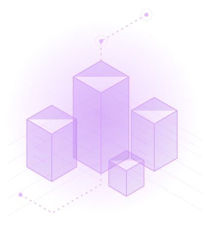

:::::: course-hero
:::: hero-copy
[Университет ИТМО · Урбанистика]{.eyebrow}

# Технологии искусственного интеллекта [в урбанистике]{.hero-accent} {.hero-title}

Изучаем возможности ИИ, разбираемся в технологиях и применяем их к задачам городской среды.

::: hero-actions
[Смотреть лекции](lectures/lectures.qmd){.btn .btn-primary} [Смотреть практики](practice/practices.qmd){.btn .btn-outline-light}
:::
::::

```{=html}
<div class="hero-visual" aria-hidden="true">
  
</div>
```

::: hero-caption
Город. Данные. Искусственный интеллект.
:::
::::::

::::: course-meta
::: course-teacher
[Преподаватель]{.meta-label}

**Натыкин Максим Викторович**

Институт дизайна и урбанистики, Университет ИТМО
:::

::: course-publication
[Дата публикации]{.meta-label}

15.10.2026
:::
:::::

::: course-intro
[О курсе]{.section-kicker}

## ИИ как инструмент для работы с городом

Курс объединяет лекции об искусственном интеллекте и практические занятия. Разбираемся, какие задачи можно решать с помощью ИИ, как выбирать подходящие методы и критически оценивать результаты.
:::

::::::: course-program
[Программа]{.section-kicker}

## От знакомства с ИИ — к его применению

:::::: lecture-grid
::: lecture-card
[01 / Лекция]{.card-kicker}

### [Современный ИИ](lectures/lecture-01.qmd){.topic-link}

Основные понятия, возможности и направления развития искусственного интеллекта.
:::

::: lecture-card
[02 / Лекция]{.card-kicker}

### [Технологии ИИ](lectures/lecture-02.qmd){.topic-link}

Технологии и подходы к решению прикладных задач с помощью ИИ.
:::

::: lecture-card
[03 / Лекция]{.card-kicker}

### [Перспективные методы ИИ](lectures/lecture-03.qmd){.topic-link}

Новые направления искусственного интеллекта и возможности их применения.
:::

::: lecture-card
[04 / Лекция]{.card-kicker}

### [Вайбкодинг](lectures/lecture-04.qmd){.topic-link}

Разработка с ИИ-агентом: постановка задачи, контекст проекта, инструменты и проверка результата.
:::
::::::
:::::::

:::: practice-feature
::: practice-copy
[Практика 01]{.section-kicker}

## Первые шаги в вайбкодинге

Подготовьте компьютер, откройте учебный Python-проект и начните работать с ИИ-агентом. В инструкции — шаги для Windows, macOS и Linux.

[Перейти к практике →](practice/practice-01.qmd){.btn .btn-primary}
:::

```{=html}
<div class="practice-symbol" aria-hidden="true">&gt;_</div>
```
::::

:::: practice-feature
::: practice-copy
[Практика 02]{.section-kicker}

## Кварталы и метрики города: от данных к дашборду

Составьте план исследования в OpenCode и поручите агенту подготовить кварталы, рассчитать показатели BlocksNet и собрать HTML-страницу с картой и дашбордом. Предварительное знание программирования не требуется.

[Перейти к практике →](practice/practice-02.qmd){.btn .btn-primary}
:::

```{=html}
<div class="practice-symbol" aria-hidden="true">02</div>
```
::::

::: materials-entry
### Продолжить знакомство с ИИ

Статьи, наглядные объяснения и полезные сервисы для самостоятельного изучения.

[Открыть дополнительные материалы →](materials/materials.qmd){.materials-link}
:::
