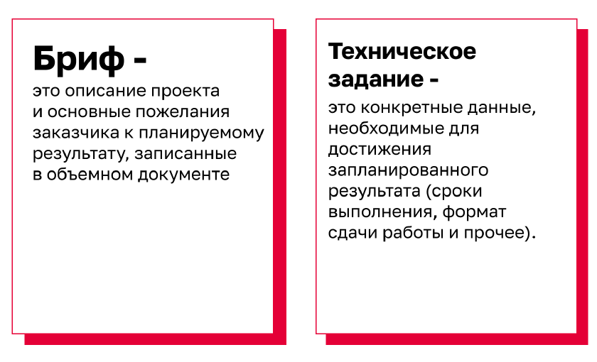
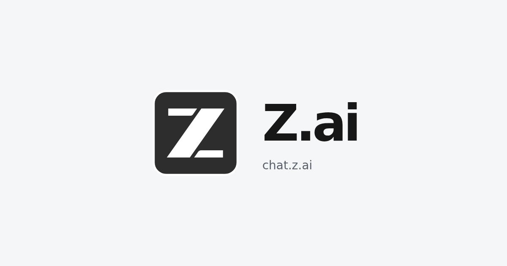
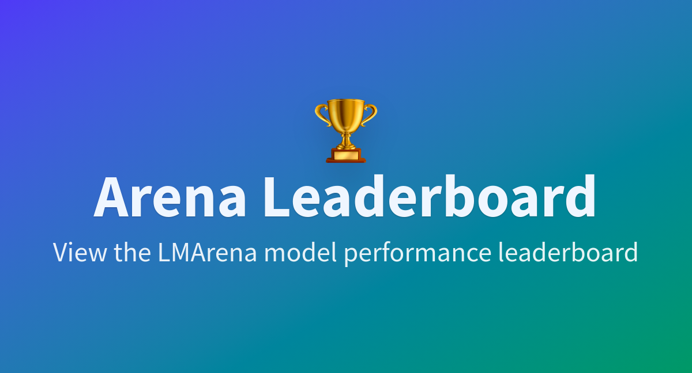

Статьи, памятки, наглядные объяснения и полезные сервисы, к которым можно обращаться во время курса и самостоятельной работы.

## Статьи и документы

```{=html}
<a class="resource-preview" href="brief.pdf" target="_blank" rel="noopener noreferrer" aria-labelledby="brief-title" aria-describedby="brief-description">
  <span class="preview-site">PDF <span aria-hidden="true">↗</span></span>
  <h2 id="brief-title">Бриф: что это такое</h2>
  <p id="brief-description">Зачем нужен бриф, чем он отличается от технического задания и как описать цели, этапы, данные и требования проекта.</p>
  
  <span class="preview-footer">Подготовка проекта <span>Открыть PDF →</span></span>
</a>

<a class="resource-preview" href="https://vas3k.blog/blog/machine_learning/" target="_blank" rel="noopener noreferrer" aria-labelledby="machine-learning-title" aria-describedby="machine-learning-description">
  <span class="preview-site">vas3k.blog <span aria-hidden="true">↗</span></span>
  <h2 id="machine-learning-title">Машинное обучение для людей</h2>
  <p id="machine-learning-description">Наглядное введение в машинное обучение: основные подходы, примеры задач и карта алгоритмов.</p>
  
  <span class="preview-footer">Вастрик <span>Читать статью →</span></span>
</a>
```

## Инструменты и сервисы

```{=html}
<a class="resource-preview" href="https://learn.chatgpt.com/docs/codex/ide#getting-started" target="_blank" rel="noopener noreferrer" aria-labelledby="codex-ide-title" aria-describedby="codex-ide-description">
  <span class="preview-site">learn.chatgpt.com <span aria-hidden="true">↗</span></span>
  <h2 id="codex-ide-title">Codex в редакторе кода: начало работы</h2>
  <p id="codex-ide-description">Официальное руководство OpenAI: установка Codex в редакторе кода, вход в аккаунт и первый диалог по проекту.</p>
  
  <span class="preview-footer">Документация OpenAI <span>Открыть руководство →</span></span>
</a>

<a class="resource-preview" href="https://opencode.ai/" target="_blank" rel="noopener noreferrer" aria-labelledby="opencode-title" aria-describedby="opencode-description">
  <span class="preview-site">opencode.ai <span aria-hidden="true">↗</span></span>
  <h2 id="opencode-title">OpenCode</h2>
  <p id="opencode-description">ИИ-агент с открытым исходным кодом для работы над кодом в терминале, редакторе и приложении для компьютера.</p>
  
  <span class="preview-footer">Работа с кодом <span>Открыть OpenCode →</span></span>
</a>

<a class="resource-preview" href="https://www.skills.sh/" target="_blank" rel="noopener noreferrer" aria-labelledby="skills-title" aria-describedby="skills-description">
  <span class="preview-site">skills.sh <span aria-hidden="true">↗</span></span>
  <h2 id="skills-title">skills.sh</h2>
  <p id="skills-description">Каталог готовых навыков для ИИ-агентов: поиск и установка инструкций для выполнения специализированных задач.</p>
  
  <span class="preview-footer">Навыки для агентов <span>Открыть каталог →</span></span>
</a>

<a class="resource-preview" href="https://chat.z.ai/" target="_blank" rel="noopener noreferrer" aria-labelledby="zai-title" aria-describedby="zai-description">
  <span class="preview-site">chat.z.ai <span aria-hidden="true">↗</span></span>
  <h2 id="zai-title">Z.ai</h2>
  <p id="zai-description">Чат с ИИ на базе моделей GLM для вопросов и работы с текстом и кодом.</p>
  
  <span class="preview-footer">Чат с ИИ <span>Открыть чат →</span></span>
</a>

<a class="resource-preview" href="https://huggingface.co/spaces/lmarena-ai/arena-leaderboard" target="_blank" rel="noopener noreferrer" aria-labelledby="arena-title" aria-describedby="arena-description">
  <span class="preview-site">huggingface.co <span aria-hidden="true">↗</span></span>
  <h2 id="arena-title">Arena Leaderboard</h2>
  <p id="arena-description">Рейтинг языковых моделей LMArena для сравнения их результатов.</p>
  
  <span class="preview-footer">Сравнение моделей <span>Открыть рейтинг →</span></span>
</a>
```

## Urbanomy {#urbanomy}

Библиотека для пространственной и экономической оценки городских территорий. Здесь собраны исходный код, плагин для QGIS и данные для знакомства с инструментом.

::: {.panel-tabset}

### Библиотека

{fig-alt="Иллюстрация Urbanomy: городские кварталы, диаграмма и знак доллара" width=660}

Urbanomy объединяет инструменты прогнозирования стоимости земли, сравнения сценариев развития кварталов и расчёта инвестиционных показателей. В репозитории доступны исходный код, примеры и инструкции.

[Urbanomy на GitHub · ветка dev](https://github.com/IDUclub/Urbanomy/tree/dev){.btn .btn-primary target="_blank" rel="noopener noreferrer"}

### Плагин для QGIS

Плагин Urbanomy позволяет рассчитывать стоимость земли, оптимизировать параметры квартала и оценивать инвестиционные показатели в QGIS. Переносимый архив включает плагин, расчётное ядро и модель CatBoost.

[Скачать плагин для QGIS · ZIP](downloads/urbanomy_qgis_portable.zip){.btn .btn-primary download="urbanomy_qgis_portable.zip"}

Как начать:

1. В QGIS откройте **Модули → Управление и установка модулей → Установить из ZIP**, выберите скачанный архив и включите **Urbanomy**.
2. Откройте **Urbanomy → Установка** и настройте вычислительное окружение через встроенный мастер. Для расчётов нужен внешний **Python 3.11**, для установки зависимостей — интернет.
3. Скачайте пример данных на соседней вкладке и добавьте GeoJSON в QGIS как векторный слой. Модель CatBoost из архива плагин подставит автоматически.

### Пример данных

GeoJSON с геометрией 351 квартала и показателями: землепользование, площадь застройки, население, плотность, морфотип и доступность территории. Файл можно открыть в QGIS и использовать для знакомства с Urbanomy.

[Скачать пример данных · GeoJSON](downloads/blocks_agg_with_indicators.geojson){.btn .btn-primary download="blocks_agg_with_indicators.geojson"}

Для подготовки кварталов и расчёта показателей для своей территории используйте [BlocksNet](https://github.com/aimclub/blocksnet). Работа с этой библиотекой разобрана в [практическом занятии 2](../practice/practice-02.qmd).

:::
