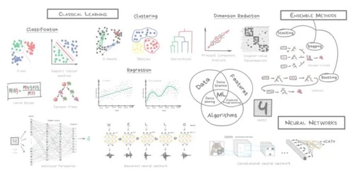

Статьи, наглядные объяснения и полезные сервисы, к которым можно обращаться во время курса и самостоятельной работы.

```{=html}
<a class="resource-preview" href="https://vas3k.blog/blog/machine_learning/" target="_blank" rel="noopener noreferrer" aria-labelledby="machine-learning-title" aria-describedby="machine-learning-description">
  <span class="preview-site">vas3k.blog <span aria-hidden="true">↗</span></span>
  <h2 id="machine-learning-title">Машинное обучение для людей</h2>
  <p id="machine-learning-description">Наглядное введение в машинное обучение: основные подходы, примеры задач и карта алгоритмов.</p>
  
  <span class="preview-footer">Вастрик <span>Читать статью →</span></span>
</a>
```

## Инструменты и сервисы

```{=html}
<a class="resource-preview" href="https://opencode.ai/" target="_blank" rel="noopener noreferrer" aria-labelledby="opencode-title" aria-describedby="opencode-description">
  <span class="preview-site">opencode.ai <span aria-hidden="true">↗</span></span>
  <h2 id="opencode-title">OpenCode</h2>
  <p id="opencode-description">ИИ-агент с открытым исходным кодом для работы над кодом в терминале, редакторе и приложении для компьютера.</p>
  <span class="preview-footer">Работа с кодом <span>Открыть OpenCode →</span></span>
</a>

<a class="resource-preview" href="https://www.skills.sh/" target="_blank" rel="noopener noreferrer" aria-labelledby="skills-title" aria-describedby="skills-description">
  <span class="preview-site">skills.sh <span aria-hidden="true">↗</span></span>
  <h2 id="skills-title">skills.sh</h2>
  <p id="skills-description">Каталог готовых навыков для ИИ-агентов: поиск и установка инструкций для выполнения специализированных задач.</p>
  <span class="preview-footer">Навыки для агентов <span>Открыть каталог →</span></span>
</a>

<a class="resource-preview" href="https://chat.z.ai/" target="_blank" rel="noopener noreferrer" aria-labelledby="zai-title" aria-describedby="zai-description">
  <span class="preview-site">chat.z.ai <span aria-hidden="true">↗</span></span>
  <h2 id="zai-title">Z.ai</h2>
  <p id="zai-description">Чат с ИИ на базе моделей GLM для вопросов и работы с текстом и кодом.</p>
  <span class="preview-footer">Чат с ИИ <span>Открыть чат →</span></span>
</a>
```
